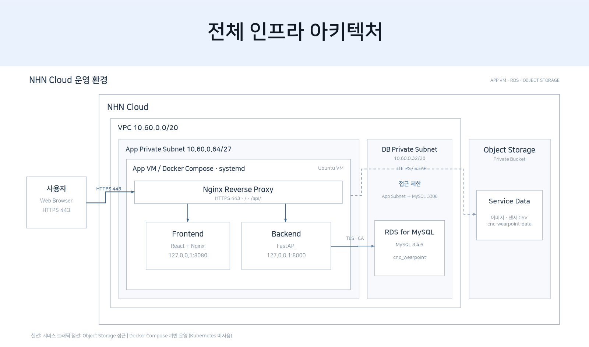

# CNC WearPoint Backend

CNC 가공 과정에서 수집한 이미지·센서 데이터와 AI 모델의 예측 결과를 활용해 **공구 마모 상태를 진단하는 CNC WearPoint 서비스의 FastAPI 백엔드**입니다.

React 기반 프론트엔드와 FastAPI를 연동하고, MySQL을 이용해 가공 조건, 측정 데이터, 실제 마모값 및 AI 모델의 최신 예측 결과를 관리합니다.

현재 NHN Cloud 환경에 App VM과 RDS를 분리하여 운영 환경을 구성했으며, 서비스 Database와 MLflow Tracking / Registry Metadata를 NHN Cloud RDS for MySQL로 관리하고 있습니다.

MLflow는 App VM에서 별도 Tracking Server로 실행하며, Basic Auth를 적용하여 인증된 사용자만 접근할 수 있도록 구성했습니다.

서비스 이미지·센서 파일과 MLflow Artifact는 NHN Cloud Object Storage의 Private Bucket으로 분리하여 관리하고, FastAPI와 MLflow가 S3 호환 API를 통해 접근하도록 구성했습니다.

AI 모델 추론은 [ml/serving](ml/serving)의 별도 Model Serving Container가 담당합니다. Serving은 기동 시 MLflow Model Registry에서 `cnc-wearpoint-multitask` 모델을 로드하고, Backend는 Serving의 `POST /predictions`를 호출해 예측 결과를 RDS에 저장합니다.

운영 환경은 Kubernetes가 아닌 **App VM의 Docker / Docker Compose** 기반으로 운영합니다.

---

## 전체 아키텍처 개요



위 그림은 GitHub 기반 소스 관리부터 GitLab CI/CD, Quay.io 이미지 관리, NHN Cloud 서비스 운영 및 MLflow 모델 관리까지의 전체 구조를 보여줍니다.

GitHub는 팀의 메인 소스 저장소로 사용하며, GitHub Actions는 GitHub의 `main` 브랜치와 Version Tag를 GitLab으로 동기화하는 역할을 담당합니다.

실제 Container Image Build, Version 승격 및 운영 배포는 GitLab CI와 GitLab Runner를 통해 수행합니다.

운영 환경에서는 Nginx를 HTTPS 단일 진입점으로 사용하여 요청 경로에 따라 Frontend, FastAPI Backend, MLflow Tracking Server로 요청을 분기합니다.

서비스 이미지·센서 파일과 MLflow Artifact의 NHN Cloud Object Storage 전환을 완료했으며, 실제 AI 모델은 MLflow Model Registry에 등록한 뒤 별도 Model Serving Container를 통해 FastAPI Prediction API와 연동했습니다.

```text
MLflow Model Registry (cnc-wearpoint-multitask)
        │  Serving 기동 시 1회 Alias → Version 해석 후 Load
        ▼
Model Serving Container (ml/serving, Port 8001)
        │  POST /predictions (image, sensor_csv)
        ▼
FastAPI Backend ──▶ RDS cnc_wearpoint (predictions / alerts / monitoring_inference_runs)
        │
        ▼
Frontend
```

---

## 관련 문서

프로젝트의 세부 설계와 운영 관련 내용은 목적에 따라 별도 문서로 관리합니다.

- [클라우드 인프라 구성](docs/infrastructure.md)  
  NHN Cloud VPC, Subnet, Routing, Security Group, App VM, RDS 및 서비스 접근 구조

- [데이터베이스 구성 및 이전 가이드](docs/database.md)  
  CNC WearPoint 서비스 DB와 MLflow Tracking / Auth DB의 구조, 검증 및 RDS 이전 현황

- [로컬 배포 및 인프라 파일 구성 안내](docs/deployment/infrastructure.md)  
  Docker Compose 실행 방법과 배포 관련 파일 구조 (문서 안의 Kubernetes 확장 계획 서술은 현재 운영 구성과 다르며, 운영은 Docker VM 기반입니다)

- [자동 예측 API 안내](docs/deployment/auto_prediction.md)  
  업로드 + 추론 통합 API(`/api/measurements/auto-predict`)와 재추론 Cookie 동작

- [예측 운영자 브라우저 인증](docs/security/prediction-browser-auth.md)  
  HttpOnly Session 기반 예측 API 인증 설정

- [공통 모니터링](docs/monitoring.md) · [공통 알림](docs/monitoring-alerts.md)  
  저장된 MATWI 파일의 공통 재생 시계와 서버 알림 생성 구조

- [사용자 입력](docs/manual-inputs.md) · [Set test 폴더 업로드](docs/manual-folder-upload.md)  
  사용자 입력 탭과 여러 파일·폴더 업로드 재생 목록

- [Model Serving](ml/serving/README.md)  
  FastAPI 기반 모델 Serving 서비스

- 모델 생명주기 문서 ([docs/model-lifecycle](docs/model-lifecycle))
  - [현재 상태](docs/model-lifecycle/MODEL_LIFECYCLE_CURRENT_STATE.md): MLflow Registry → Serving → Backend → RDS 경로의 코드·운영 확인 결과
  - [테스트 계획](docs/model-lifecycle/MODEL_LIFECYCLE_TEST_PLAN.md): 모델 승격·롤백 검증 항목
  - [승격·롤백 절차](docs/model-lifecycle/MODEL_PROMOTION_ROLLBACK_RUNBOOK.md): 운영 Serving Container의 Alias 전환 및 롤백 Runbook
  - [검증 보고서](docs/model-lifecycle/MODEL_LIFECYCLE_VERIFICATION_REPORT.md): 오프라인 테스트 및 운영 read-only 조회 결과

---

## 1. 개발 환경

현재 백엔드 개발 환경은 다음과 같습니다.

| 항목 | 구성 |
|---|---|
| Language | Python 3.12.10 |
| Backend | FastAPI |
| Database | MySQL |
| Package Manager | uv |
| Container | Docker |
| API Documentation | Swagger |
| ML Experiment Tracking | MLflow 3.18.0 |
| Model Registry | MLflow Model Registry (`cnc-wearpoint-multitask`) |
| Model Serving | FastAPI + PyTorch CPU (Python 3.11, 별도 Container) |
| Object Storage SDK | boto3 |
| Image / Sensor 검증 | Pillow, pandas, NumPy, SciPy |
| File / Artifact Storage | NHN Cloud Object Storage (S3-compatible) |
| Cloud | NHN Cloud |
| 운영 환경 | App VM + Docker Compose (Kubernetes 미사용) |
| CI/CD | GitHub Actions + GitLab CI/CD |
| Container Registry | Quay.io |

### 사전 준비

- [Git](https://git-scm.com/downloads)
- [Python 3.12.10](https://www.python.org/downloads/release/python-31210/)
- [uv](https://docs.astral.sh/uv/getting-started/installation/)
- [Docker Desktop](https://www.docker.com/products/docker-desktop/) — Docker 실행 시 필요

Windows PowerShell에서 uv를 설치합니다.

```powershell
winget install --id astral-sh.uv -e
```

설치 후 터미널을 다시 열고 정상적으로 설치되었는지 확인합니다.

```powershell
uv --version
```

---

## 2. 로컬 실행

아래 명령은 Windows PowerShell과 프로젝트 저장소 루트를 기준으로 합니다.

### 2.1 프로젝트 Clone

```powershell
git clone https://github.com/Goodee-AIM/cnc-wearpoint-backend.git
cd cnc-wearpoint-backend
```

### 2.2 개발 환경 구성

```powershell
uv sync
```

`pyproject.toml`, `uv.lock`, `.python-version`을 기준으로 Python 가상환경과 필요한 패키지를 구성합니다.

`uv sync`를 사용하므로 별도로 `.venv`를 생성하거나 활성화할 필요는 없습니다.

### 2.3 환경변수 설정

```powershell
Copy-Item .env.example .env
```

생성된 `.env` 파일에서 개발 환경에 필요한 값을 설정합니다.

`.env`에는 Database Password 등 민감정보가 포함될 수 있으므로 **GitHub에 커밋하지 않습니다.**

예측·모니터링 관련 주요 환경변수는 다음과 같습니다. 예측 관련 기능은 기본값이 모두 비활성화(`0`)입니다.

| 변수 | 기본값 | 역할 |
|---|---|---|
| `SERVING_URL` | `http://cnc-wearpoint-serving:8001` | Backend가 호출할 Model Serving 주소 |
| `PREDICTION_MODEL_NAME` | `cnc-wearpoint-multitask` | Serving 응답에서 허용할 모델 이름 |
| `PREDICTION_API_ENABLED` | `0` | 예측 API 활성화 |
| `PREDICTION_API_TOKEN` | - | 서버 간 호출용 비공개 Token (브라우저·`VITE_*`에 넣지 않음) |
| `AUTO_PREDICTION_ENABLED` / `AUTO_PREDICTION_ORIGIN` | `0` / - | 업로드 + 자동 추론 API 활성화 및 허용 HTTPS Origin |
| `PREDICTION_OPERATOR_*`, `PREDICTION_SESSION_SECRET`, `PREDICTION_BROWSER_ORIGIN` | - | 운영자 브라우저 Session 인증 설정 |
| `MONITORING_CONTROL_TOKEN` | - | 공통 재생 시작·일시정지·초기화 제어 Token |
| `MONITORING_INFERENCE_ENABLED` | `0` | Set4~11 공통 재생 중 Serving 추론 Worker 및 Set별 재생 Gate 활성화 |
| `MONITORING_ALERT_WORKER_ENABLED` | `1` | 기존 공통 재생 알림 Worker. `MONITORING_INFERENCE_ENABLED=1`일 때는 `0`으로 설정해야 기동됩니다 |

변수 목록과 설명은 [.env.example](.env.example)을 참고합니다.

### 2.4 FastAPI 실행

```powershell
uv run python -m uvicorn app.main:app --reload
```

기본 접속 주소:

```text
http://localhost:8000
```

Swagger API 문서:

```text
http://localhost:8000/docs
```

---

## 3. 주요 API

현재 구현된 주요 API는 다음과 같습니다. 전체 목록과 요청 형식은 Swagger(`/docs`)에서 확인할 수 있습니다.

| Method | 주소 | 기능 |
|---|---|---|
| GET | `/health` | 서버 상태 확인 |
| GET | `/api/test` | React ↔ FastAPI 통신 테스트 |
| GET | `/api/sets` | Set 4~11 목록과 Set별 측정 수 조회 |
| GET | `/api/sets/{set_number}/measurements` | 선택한 Set의 측정·원본 정답·최신 예측 조회 |
| GET | `/api/images/{set_id}` | 이미지 목록 조회 (운영: Object Storage) |
| GET | `/api/images/{set_id}/{filename}` | 이미지 파일 조회 (운영: Object Storage Streaming) |
| GET | `/api/sensors/{set_id}/{filename}` | 센서 CSV 파일 조회 (운영: Object Storage Streaming) |
| GET | `/api/sensors/{set_id}/{filename}/cutting-segment` | 저장된 센서 CSV의 절삭 구간 경계(초 단위) 조회 |
| POST | `/api/sensors/cutting-segment` | Set test로 선택한 센서 CSV의 절삭 구간 경계 계산 (DB·Storage 저장 없음) |
| POST | `/api/measurements` | 이미지 + 센서 CSV 업로드 및 Measurement 생성 |
| GET | `/api/measurements/{measurement_id}` | Measurement 단건 조회 |
| POST | `/api/measurements/{measurement_id}/predict` | Serving 추론 실행 및 결과 저장 (서버 Token 또는 운영자 Session 필요) |
| POST | `/api/measurements/auto-predict` | 업로드 + Serving 추론 + 결과 저장을 한 번에 처리 (기본 비활성화) |
| POST | `/api/measurements/{measurement_id}/retry` | 추론 실패한 업로드의 재추론 (업로드별 HttpOnly Cookie 필요) |
| POST | `/api/measurements/{measurement_id}/replay-predict` | 업로드 성공 건의 동일 파일 재추론 (업로드별 HttpOnly Cookie 필요) |
| POST / GET / POST | `/api/prediction-auth/login`, `/session`, `/logout` | 예측 운영자 로그인·Session 확인·로그아웃 |
| GET | `/api/monitoring/state` | 공통 모니터링 재생 상태 조회 |
| POST | `/api/monitoring/start`, `/pause`, `/reset` | 공통 재생 제어 (`X-Monitoring-Control-Token` 필요) |
| POST | `/api/monitoring/restart` | 알림 기록과 세션을 유지한 채 재생 위치만 처음으로 되돌림 |
| GET | `/api/monitoring/inference/current` | 현재 재생 위치의 모니터링 추론 실행 상태 조회 |
| GET / PATCH | `/api/monitoring/alerts`, `/api/monitoring/alerts/{record_id}/acknowledge` | 공통 재생 알림 이력 조회 및 확인 처리 |
| POST / GET / PATCH | `/api/alerts`, `/api/alerts/{alert_id}/acknowledge` | 예측 기반 알림 생성·조회·확인 처리 |
| POST / GET | `/api/manual-inputs`, `/api/manual-inputs/playlists` | 사용자 입력 파일 및 재생 목록 저장·조회 |
| GET | `/api/manual-inputs/{identifier}`, `/image`, `/sensor` | 사용자 입력 단건·이미지·센서 조회 |
| GET | `/docs` | Swagger API 문서 |

정상 응답 예시:

```json
{
  "status": "ok"
}
```

프론트엔드 개발 서버는 기본적으로 다음 주소를 사용합니다.

```text
http://localhost:5173
```

프론트엔드 포트가 변경되는 경우 백엔드 `.env`의 `CORS_ORIGINS` 설정도 함께 변경해야 합니다.

### 3.1 Set 및 측정 데이터

Database 구조는 [sql/cnc/schema.sql](sql/cnc/schema.sql)을 기준으로 관리합니다.

Schema 파일은 신규 Database 초기화에 사용하며, 이미 생성된 Database의 Column을 자동으로 변경하지 않습니다.

기존 Database 변경은 Migration SQL로 적용합니다. 공통 모니터링·알림·모니터링 추론 테이블은 [sql/cnc/migrations](sql/cnc/migrations), 사용자 업로드(`source_type`, `input_issue_reason`)와 예측 Claim 복구(`prediction_claim_id`, `prediction_started_at`) Column은 [migrations](migrations)에서 관리합니다.

- Set 목록의 내부 기본키는 `set_id`를 사용합니다.
- API URL의 `set_number`는 원본 데이터셋의 Set 번호인 4~11을 사용합니다.
- 측정 데이터는 `image_id`, `sensor_id`, `original_wear_um`, `original_type`을 사용합니다.
- AI 예측값은 `predicted_wear_um`으로 관리하여 실제 마모값과 구분합니다.
- 예측 결과에는 `model_version`, `prediction_status`, `predicted_at`을 함께 관리합니다.
- 마모 판정 기준은 Warning 150 µm, Danger 200 µm이며([app/core/wear_policy.py](app/core/wear_policy.py)), Serving이 반환한 판정값 대신 Backend가 이 기준으로 다시 계산합니다.
- 실제값 또는 예측값이 존재하지 않는 경우 관련 필드는 `null`을 반환합니다.
- 최신 예측은 `predicted_at`, `id`의 내림차순을 기준으로 결정합니다.
- 운영 환경의 유효 이미지·센서 경로는 Object Storage Key(`images/...`, `sensors/...`)로 관리합니다.
- 품질 기준 미달로 제외한 이미지 9건은 후속 상태 모델링을 위해 기존 경로 정보를 유지하고 있습니다.

측정 조회 API는 Pagination을 지원합니다.

| Parameter | 기본값 | 최대값 |
|---|---:|---:|
| `limit` | 200 | 500 |
| `offset` | 0 | - |

예시:

```text
/api/sets/4/measurements?limit=50&offset=0
```

### 3.2 측정 데이터 업로드 및 입력 검증

`POST /api/measurements`는 이미지와 센서 CSV를 받아 `images/uploads/upload-<UUID>/`, `sensors/uploads/upload-<UUID>/` 경로에 저장한 뒤 `source_type='upload'`인 Measurement를 생성합니다. DB 저장에 실패하면 이미 저장한 파일을 삭제합니다.

업로드 검증은 Serving([ml/serving/service.py](ml/serving/service.py))의 입력 기준과 맞춰, Serving에서 거절될 파일을 업로드 단계에서 미리 차단합니다.

| 항목 | 기준 |
|---|---|
| 이미지 형식 | PNG / JPEG, 8MB 이하. Pillow로 실제 픽셀까지 디코딩하여 손상 여부 확인 |
| 이미지 크기 | 600x400 ROI 이미지 또는 1750x1070 이상의 고정 카메라 원본 (고정 ROI `1150, 670, 1750, 1070` 적용) |
| 센서 CSV | 헤더 없는 6열(acc, audio, force_x, force_y, force_z, timestamp), 20MB 이하 |
| Timestamp | 중복·역행 불가, 파일 내 샘플링 간격 일정 |
| 최소 행 수 | 데이터 512행 이상 (모델 Window Size 기준) |

### 3.3 AI 예측 연동 (Backend ↔ Model Serving)

Backend는 Object Storage에서 Measurement의 이미지·센서 파일을 읽어 Serving의 `POST /predictions`로 전달하고, 응답의 `model_name`, `model_version`(MLflow Registry Version 번호), 예측 마모량과 마모 유형을 검증한 뒤 `predictions`에 저장합니다. Warning / Danger 판정이면 `alerts`도 함께 저장합니다.

- 예측 시작 시 Measurement를 `predicting` 상태로 Claim하여 중복 예측을 막고, Serving 호출 중에는 DB Lock을 잡지 않습니다.
- 중단된 Claim은 자동으로 초기화하지 않으며, 운영자가 [scripts/recover_stale_prediction.py](scripts/recover_stale_prediction.py)로 최소 30분 경과 후 명시적으로 복구합니다.
- `/predict`는 서버 간 `X-Prediction-Token` 또는 운영자 HttpOnly Session으로 호출합니다. 브라우저에는 `PREDICTION_API_TOKEN`을 전달하지 않습니다.

Serving 오류는 원인에 따라 다르게 응답합니다.

| Serving 결과 | Backend 응답 | 재추론 |
|---|---|---|
| HTTP 400 (입력 파일 거절) | `422` `{code: "INPUT_REJECTED", message, measurement_id}` | 재추론 Cookie 미발급 (같은 파일은 다시 거절되므로) |
| 그 밖의 오류·연결 실패·Timeout | `502` (`auto-predict`·`retry`는 `INFERENCE_FAILED` 코드) | `auto-predict` 실패 시 재추론 Cookie 발급 |

`/predict`, `auto-predict`, `retry` 경로에서는 두 경우 모두 Measurement를 `failed` 상태로 표시합니다. Serving 호출 Timeout은 180초입니다.

수동 요청(Set test 업로드·재추론·재생)과 모니터링 추론은 프로세스 내에서 서로 다른 추론 Slot을 사용합니다([app/services/inference_capacity.py](app/services/inference_capacity.py)). 따라서 모니터링 추론이 진행 중이어도 수동 요청이 `429 PREDICTION_BUSY`로 실패하지 않으며, 각 종류별로 동시에 1건씩 Serving을 호출합니다.

### 3.4 공통 모니터링 재생 및 추론

Set4~11의 저장된 이미지·센서 파일을 서버 기준 공통 시계로 재생합니다. 센서 재생 시간은 **2배속**으로 진행하며([app/services/playback_speed.py](app/services/playback_speed.py)), 추론 처리 시간과 결과 표시 시간은 배속의 영향을 받지 않습니다. 재생 상태 응답에는 `playback_rate`가 포함되며, 공통 알림의 발생 시각은 배속을 고려해 실제 시각으로 환산하여 기록합니다.

`MONITORING_INFERENCE_ENABLED=1`이면 Set별 재생 Gate와 모니터링 추론 Worker가 동작합니다.

- 각 Set의 센서 재생이 끝나면 해당 재생 회차의 추론 결과를 기다린 뒤 3초간 표시하고 다음 Measurement로 넘어갑니다.
- 추론 Worker는 재생 Gate 진행·추론 등록 Loop와 Serving 호출 Loop를 분리하여, Serving 호출 중에도 다른 Set의 재생 Gate가 계속 진행됩니다([app/services/monitoring_inference_queue.py](app/services/monitoring_inference_queue.py)).
- 여러 Backend 프로세스 사이의 Serving 호출은 MySQL `GET_LOCK`으로 직렬화합니다.
- 추론 결과는 `monitoring_inference_runs`에 기록하며, 실패 시 `error_code`를 `INPUT_REJECTED` 또는 `INFERENCE_FAILED`로 구분합니다. `/api/monitoring/inference/current`는 실패·취소된 실행의 `error_code`를 함께 반환합니다.

### 3.5 절삭 구간 조회

센서 차트의 절삭 구간 표시를 위해 Force X/Y 신호 에너지를 기준으로 절삭 구간 경계를 계산합니다([app/services/cutting_segment.py](app/services/cutting_segment.py)).

- `GET /api/sensors/{set_id}/{filename}/cutting-segment`: Set4~11의 저장된 센서 파일 기준
- `POST /api/sensors/cutting-segment`: Set test에서 선택한 센서 CSV 기준 (DB·Storage·추론 기록을 남기지 않음)

---

## 4. 데모 예측 데이터 등록

Model Serving 연동 이전에 Backend 조회 흐름을 검증하기 위해 사용한 기능으로, CSV 형태의 데모 예측 결과를 Database에 등록할 수 있습니다. 실제 서비스 예측은 [3.3 AI 예측 연동](#33-ai-예측-연동-backend--model-serving)의 Serving 경로를 사용합니다.

프로젝트 루트에 다음 파일을 준비합니다.

```text
rf_test_predictions.csv
```

필수 Column:

```text
Set
ImageName
Predicted_Wear
```

선택 Column:

```text
SensorName
```

예측 결과를 등록합니다.

```powershell
uv run python import_predictions.py
```

현재 데모 모델 정보는 다음과 같습니다.

| 항목 | 값 |
|---|---|
| Model Name | `rf-csv-demo` |
| Model Version | `rf-csv-demo-v1` |
| Warning Threshold | 50 µm |
| Danger Threshold | 90 µm |

위 Threshold는 데모 Script(`import_predictions.py`)에서 저장 시 사용하는 값이며, 현재 서비스 판정 기준(Warning 150 µm / Danger 200 µm)과 다릅니다. 데모 예측 행은 `model_version`이 `rf-csv-demo-v1`이므로 MLflow Registry Version 기준 집계에서 제외해야 합니다.

동일한 Measurement, Model Name 및 Model Version에 동일한 예측값이 이미 존재하는 경우 중복 저장하지 않습니다.

모델이 변경되거나 새로운 예측 결과를 관리해야 하는 경우 새로운 `model_version`을 사용합니다.

---

## 5. 자동 테스트

전체 테스트는 다음 명령으로 실행합니다.

```powershell
uv run python -m pytest -q
```

현재 테스트에서는 다음 항목을 확인합니다.

- 기본 API 연결
- Set 및 Measurement API 응답 구조
- Pagination 처리
- 잘못된 요청에 대한 오류 처리
- CSV 예측 데이터 등록
- Model Name 및 Version 구분
- 중복 예측 처리
- Warning / Danger 경계값 처리 (150 / 200 µm)
- 업로드 이미지·센서 CSV 검증 (Serving 입력 기준과 일치)
- Serving 호출, 결과 검증·저장, `INPUT_REJECTED` / `INFERENCE_FAILED` 오류 매핑
- 자동 예측·재추론·재생 Cookie, 운영자 Session 인증
- 수동 / 모니터링 추론 Slot 분리
- 공통 모니터링 재생, 2배속 재생, Set별 재생 Gate, 모니터링 추론 Queue 및 중단 복구
- 공통 알림 생성 시각과 알림 이력
- 절삭 구간 계산
- 모델 생명주기 계약 테스트 ([tests/model_lifecycle](tests/model_lifecycle)): Serving의 Alias → Version 해석·`/health` 응답, Backend ↔ Serving 응답 계약을 오프라인으로 검증

Database 관련 회귀 테스트는 Mock Connection, Memory DB 및 임시 CSV를 사용하며 **실제 MySQL 데이터를 변경하지 않도록 구성했습니다.**

`tests/model_lifecycle/test_registry_integration.py`는 실제 MLflow Registry를 read-only로 조회하는 통합 테스트로, `MODEL_LIFECYCLE_INTEGRATION=1`과 `MLFLOW_TRACKING_URI`를 설정한 경우에만 실행되며 기본적으로 skip됩니다.

2026-11-20 기준 로컬 전체 테스트 결과는 `277 passed, 10 skipped`입니다.

---

## 6. Docker 실행

Docker Desktop이 실행 중인 환경에서 Backend Container를 생성할 수 있습니다.

### 6.1 Docker Build용 의존성 생성

```powershell
uv export --format requirements-txt --no-dev --no-emit-project --no-hashes --output-file requirements.txt
```

### 6.2 이미지 Build

```powershell
docker build -t cnc-wearpoint-backend:dev .
```

### 6.3 Container 실행

```powershell
docker run --rm --env-file .env -p 127.0.0.1:8000:8000 cnc-wearpoint-backend:dev
```

기존 프로세스가 8000 Port를 사용하고 있는 경우 먼저 해당 프로세스를 종료해야 합니다.

### 6.4 이미지 Version 관리

| Tag | 용도 |
|---|---|
| `dev` | 로컬 개발 및 테스트 |
| Commit SHA | CI/CD Build 결과 식별 |
| `vX.Y.Z` | 운영 배포 Version |
| `latest` | 승인된 최신 운영 이미지 |

최신 릴리스 운영 Backend 이미지:

```text
quay.io/melona240/cnc-wearpoint-backend:v0.1.12
```

운영 CI/CD에서는 Commit SHA 기반 이미지를 생성한 뒤 Version Tag와 `latest`로 승격하여 배포합니다. 릴리스 순서는 다음과 같습니다.

1. `main` 브랜치 Push
2. GitLab CI가 Quay.io에 Commit SHA 이미지를 게시할 때까지 대기
3. 같은 Commit에 `vX.Y.Z` Tag Push → `promote_image` + `deploy_backend` 실행

`promote_image`는 같은 Commit의 SHA 이미지를 Pull하여 승격하므로, SHA 이미지가 게시되기 전에 Tag를 Push하면 승격이 실패합니다.

### 6.5 Model Serving 이미지

Model Serving은 Backend와 별도 이미지로 관리합니다.

```text
quay.io/melona240/cnc-wearpoint-serving
```

| Tag | 용도 |
|---|---|
| Commit SHA | `main`에서 `ml/serving/**`가 변경된 경우 GitLab CI가 Build |
| `vX.Y.Z` / `latest` | `serving-vX.Y.Z` Git Tag Push 시 같은 Commit의 SHA 이미지를 승격 |

Serving 이미지는 Python 3.11 + CPU 전용 PyTorch 기반이며 Port 8001에서 `/health`, `/predictions` 두 개의 API를 제공합니다. 운영 VM에서의 실행 방법은 [8.8 Model Serving 운영](#88-model-serving-운영)을 참고합니다.

---

## 7. 의존성 관리

팀원 간 개발 환경을 동일하게 유지하고 패키지 Version을 재현하기 위해 **uv**를 사용합니다.

| 파일 | 역할 |
|---|---|
| `pyproject.toml` | 프로젝트 의존성 및 개발 도구 정의 |
| `uv.lock` | 실제 사용 Dependency Version 고정 |
| `requirements.txt` | Docker Build용 자동 생성 파일 |

패키지를 추가하거나 삭제할 때는 다음 명령을 사용합니다.

```powershell
uv add <package>
uv remove <package>
```

`requirements.txt`는 직접 수정하지 않고 `uv export`를 통해 생성합니다.

업로드 이미지 디코딩 검증을 위해 Backend 의존성에 Pillow를 포함합니다.

Model Serving의 의존성은 Backend와 분리하여 [ml/serving/requirements.txt](ml/serving/requirements.txt)에서 관리합니다. Serving은 Python 3.11 기반이며 `torch==2.15.0+cpu`, `torchvision==0.29.2+cpu`, `mlflow==3.18.0`을 고정 Version으로 사용합니다.

의존성 관리 방식은 FastAPI 공식 Full Stack Template의 구성을 참고했습니다.

참고: [FastAPI Full Stack Template](https://github.com/fastapi/full-stack-fastapi-template)

---

## 8. Database 및 인프라 구성

NHN Cloud RDS for MySQL을 사용하며 서비스 데이터, MLflow Metadata, MLflow 인증 정보를 Database 단위로 분리하여 관리합니다.

```text
NHN Cloud RDS for MySQL
│
├── cnc_wearpoint
│   └── CNC WearPoint 서비스 데이터
│
├── mlflow
│   └── MLflow Tracking / Model Registry Metadata
│
└── mlflow_auth
    └── MLflow Basic Auth 사용자 및 권한 정보
```

### 8.1 CNC WearPoint 서비스 DB

`cnc_wearpoint` Database에는 다음 데이터를 저장합니다.

- Set 및 가공 조건
- Measurement 데이터
- 실제 마모값
- AI 모델 예측 결과 (`model_name`, MLflow Registry `model_version` 포함)
- Warning / Danger 상태 및 Alert 정보
- 공통 모니터링 재생 상태, 공통 알림 이력, 모니터링 추론 실행 기록(`monitoring_inference_runs`)과 Set별 재생 Gate

로컬 MySQL 데이터를 NHN Cloud RDS로 이전했으며, App VM에서 RDS 연결 및 API 조회를 검증했습니다.

Object Storage 전환 시 `measurements.image_path`와 `sensor_path`도 실제 Object Storage Key에 맞춰 마이그레이션했습니다. 현재 유효 이미지 824건은 `images/...`, 센서 895건은 `sensors/...` 형식으로 관리합니다. 품질 기준 미달 이미지 9건은 후속 상태 컬럼 추가 전까지 기존 경로 정보를 유지합니다.

### 8.2 MLflow Tracking / Registry DB

`mlflow` Database는 MLflow의 Backend Store로 사용합니다.

MLflow 3.18.0의 Database Migration을 적용했으며 Experiment, Run, Parameter, Metric 등 Tracking 데이터를 RDS MySQL에 정상 저장하는 것을 검증했습니다.

```text
Python MLflow Client
        │
        ▼
MLflow Tracking Server
        │
        ▼
RDS MySQL
        │
        └── mlflow
```

테스트 Experiment와 Run을 생성하고 Parameter 및 Metric 데이터가 RDS에 정상 저장되는 것을 확인했습니다.

현재 실제 서비스 모델은 Model Registry에 `cnc-wearpoint-multitask`로 등록되어 있습니다.

| Version | Alias | 설명 |
|---|---|---|
| 1 | `candidate` | 최초 등록 모델 |
| 2 | `candidate-opt` | Version 1과 같은 Checkpoint에 추론 최적화를 적용한 모델 (ResNet18 이미지 특징을 Sensor Window마다가 아니라 요청당 1회만 계산) |

2026-11-20부터 운영 Serving은 `MODEL_ALIAS=candidate-opt`(Version 2)를 사용합니다. Version 1과 Version 2의 출력이 동일함을 확인한 뒤 전환했으며, 전환 후 운영 모니터링 추론 시간은 평균 약 5.2초에서 약 1.1초로, 추론 대기 시간은 최대 43초에서 약 1~2초 수준으로 줄었습니다. Registry Alias 자체는 변경하지 않고 Serving의 `MODEL_ALIAS` 환경변수만 변경했습니다.

참고로 2026-11-13에는 별도의 임시 Regression Model(이후 삭제)로 `champion` Alias의 V1 → V2 승격, Alias 기반 Model Load, V1 Rollback을 확인했습니다. 이 테스트는 Registry Alias 동작에 대한 과거 검증 기록이며, 현재 운영 Serving은 `champion` Alias를 사용하지 않습니다. 현재 승격·롤백 절차는 [MODEL_PROMOTION_ROLLBACK_RUNBOOK.md](docs/model-lifecycle/MODEL_PROMOTION_ROLLBACK_RUNBOOK.md)를 기준으로 합니다.

### 8.3 MLflow 인증 DB

MLflow Basic Auth의 사용자 및 권한 데이터는 `mlflow_auth` Database로 분리하여 관리합니다.

```text
mlflow_auth
├── users
├── roles
├── user_role_assignments
├── experiment_permissions
├── registered_model_permissions
└── ...
```

Tracking / Registry Metadata와 인증 정보를 분리하여 관리하며, 비인증 사용자의 MLflow API 접근이 `401 Unauthorized`로 차단되는 것을 확인했습니다.

### 8.4 NHN Cloud 네트워크 구성

현재 운영 환경은 다음 구조를 사용합니다.

```text
사용자
  │
  ▼
Internet
  │
  ▼
DuckDNS + HTTPS
  │
  ▼
Nginx Reverse Proxy
  │
  ├── /         → Frontend
  │
  ├── /api/     → FastAPI Backend
  │
  └── /mlflow/  → MLflow Tracking Server
  │
  ▼
App VM (Docker)
  │
  ├── FastAPI Backend Container → Model Serving Container
  │     (Docker Network로 호출, Host Port는 127.0.0.1:8001에만 바인딩)
  │
  ├── VPC Internal → RDS for MySQL
  │
  └── S3-compatible API → NHN Cloud Object Storage
```

RDS는 외부 인터넷에 직접 노출하지 않고 Private Network에 배치하여 App VM에서 필요한 Database 접근만 허용하도록 구성했습니다.

### 8.5 MLflow 운영

MLflow Tracking Server는 App VM의 Python Virtual Environment에서 실행하며 systemd 서비스로 등록하여 SSH Session과 관계없이 상시 실행되도록 구성했습니다.

```text
systemd
  │
  ▼
MLflow Tracking Server
  │
  ├── Tracking / Registry → RDS mlflow
  ├── Basic Auth          → RDS mlflow_auth
  └── Model / Run Artifact → Object Storage
```

외부 접근은 5000 Port를 직접 공개하지 않고 Nginx와 HTTPS를 통해 `/mlflow/` 경로로 제공합니다.

### 8.6 Object Storage

서비스 파일과 MLflow Artifact를 Database 또는 App VM 로컬 디스크에 직접 종속시키지 않고 NHN Cloud Object Storage의 Private Bucket으로 분리하여 관리합니다.

```text
NHN Cloud Object Storage
│
├── cnc-wearpoint-data
│   ├── images/
│   │   └── set4~set11/original/
│   └── sensors/
│       └── set4~set11/
│
└── cnc-wearpoint-mlflow
    └── mlflow-artifacts/
```

`cnc-wearpoint-data`에는 MATWI 유효 이미지 824개와 센서 CSV 895개, 총 1,719개 객체를 저장했습니다. FastAPI는 `STORAGE_BACKEND=s3` 운영 설정에서 boto3를 사용해 Private Bucket의 객체를 조회하고, `/api/images/...`와 `/api/sensors/...`를 통해 Streaming Response로 제공합니다.

운영 Backend Container의 로컬 `storage` Volume Mount를 제거한 상태에서도 이미지와 센서 API가 `HTTP 200`으로 정상 응답하는 것을 확인하여, 운영 파일 조회가 App VM 로컬 파일에 의존하지 않음을 검증했습니다.

`cnc-wearpoint-mlflow`는 MLflow Artifact Store로 사용하며, Model 및 Run Artifact가 S3 호환 API를 통해 Object Storage에 저장되는 것을 E2E로 검증했습니다.

두 Bucket 모두 `PRIVATE` 정책을 유지하며, 브라우저가 Object Storage에 직접 접근하지 않고 FastAPI 또는 MLflow를 통해 인증된 경로로 접근하도록 구성합니다.

### 8.7 RDS TLS / CA 검증

FastAPI와 MLflow의 RDS 연결은 `REQUIRE SSL` 계정을 사용하며 실제 Session에서 TLS 1.3 연결을 확인했습니다.

NHN Cloud RDS에서 발급한 CA File을 App VM에 배치하고 다음 연결에 CA Certificate Verification을 적용했습니다.

```text
FastAPI        → RDS cnc_wearpoint  : TLS 1.3 + CA 검증
MLflow         → RDS mlflow         : TLS 1.3 + CA 검증
MLflow Auth    → RDS mlflow_auth    : TLS 1.3 + CA 검증
```

운영 Secret은 `/etc/cnc-wearpoint/*.env` 및 `/etc/mlflow/mlflow.env`에서 관리하며 Git에 Commit하지 않습니다. GitLab Runner는 배포 전용 Group을 통해 필요한 env 파일만 읽을 수 있도록 제한합니다.

세부 내용은 다음 문서에서 확인할 수 있습니다.

- [NHN Cloud 인프라 구성](docs/infrastructure.md)
- [Database 구성 및 RDS 이전](docs/database.md)

### 8.8 Model Serving 운영

Model Serving([ml/serving](ml/serving))은 Backend와 별도의 Container로 실행합니다. Serving 실행 정의는 저장소가 아닌 운영 VM의 `/opt/cnc-wearpoint/serving/compose.yaml`에 있으며, Backend와 다른 Compose Project이므로 Backend 배포(`deploy_backend`)가 Serving Container를 재생성하거나 제거하지 않습니다.

```text
/opt/cnc-wearpoint/serving/compose.yaml   # Serving 실행 정의 (수동 운영)
/etc/cnc-wearpoint/inference.env          # MODEL_NAME, MODEL_ALIAS, MLFLOW_TRACKING_URI, MLflow 자격증명 (root 전용)
```

- Serving은 `MODEL_NAME`(기본 `cnc-wearpoint-multitask`)과 `MODEL_ALIAS`(기본 `candidate`)로 모델을 선택합니다.
- **Alias는 Container 기동 시 한 번만 Version으로 해석**하고, 이후 `models:/{name}/{version}`을 Load합니다. 실행 중에는 Alias를 다시 조회하지 않으며 Reload API도 없습니다.
- 따라서 Registry Alias를 옮기거나 `MODEL_ALIAS`를 변경해도 Serving Container를 **재생성**해야 반영됩니다. 반대로 의도하지 않은 재시작(VM Reboot 등)이 발생하면 그 시점에 Alias가 가리키는 Version이 Load됩니다.
- `/health`는 `model_name`, `model_alias`, `model_version`(기동 시 해석한 Version), `model_loaded`를 반환합니다.
- MLflow 접속이나 모델 Load에 실패하면 Fallback 없이 기동이 실패합니다.

env 파일은 root만 읽을 수 있으므로 `docker compose`는 `sudo`로 실행합니다. 환경변수는 Container 생성 시 고정되므로 `docker restart`로는 변경 사항이 반영되지 않습니다.

```bash
cd /opt/cnc-wearpoint/serving
sudo docker compose up -d --force-recreate --pull never serving
curl -s http://127.0.0.1:8001/health
```

현재 운영 Serving의 `/health` 기준 모델은 `model_alias: candidate-opt`, `model_version: 2`입니다. 모델 전환·롤백 절차와 사전 점검 항목은 [MODEL_PROMOTION_ROLLBACK_RUNBOOK.md](docs/model-lifecycle/MODEL_PROMOTION_ROLLBACK_RUNBOOK.md)를 따릅니다.

> [ml/serving/register_candidate.py](ml/serving/register_candidate.py)는 기본값으로 운영 MLflow에 새 Version을 등록하고 `candidate` Alias를 즉시 새 Version으로 옮깁니다. 이 변경은 다음 Serving 재생성 시 운영에 반영되므로 실행 전 Tracking URI와 Alias를 반드시 확인합니다.

---

## 9. 백엔드 CI/CD

GitHub를 팀의 메인 소스 저장소로 사용합니다.

GitHub의 `main` 브랜치 또는 `v*` / `serving-v*` Tag를 Push하면 [GitHub Actions](.github/workflows/sync-to-gitlab.yml)가 해당 Branch 또는 Tag를 GitLab 저장소에 동기화합니다.

```text
GitHub
   │
   ▼
GitHub Actions
   │
   │ Source / Tag Sync
   ▼
GitLab
```

GitHub Actions는 메인 CI/CD Build Engine이 아니라 **GitHub → GitLab 동기화 역할**을 담당합니다.

GitLab로 소스가 동기화되면 [GitLab CI](.gitlab-ci.yml)가 `cnc-wp-runner`에서 실제 Container Image Build 및 배포 Pipeline을 수행합니다.

```text
GitLab
  │
  ▼
GitLab CI
  │
  ▼
GitLab Runner
  │
  ├── Build
  ├── Image Push
  ├── Promote
  └── Deploy
       │
       ▼
     Quay.io
       │
       ▼
NHN Cloud App VM
```

| 트리거 | GitLab CI Job | 동작 |
|---|---|---|
| `main` Commit | `build_image` | Backend Docker Image를 Build하고 Commit SHA Tag로 Quay.io에 게시 |
| `vX.Y.Z` Tag | `promote_image`, `deploy_backend` | 동일 Commit의 Backend SHA Image를 Version Tag 및 `latest`로 승격 후 운영 VM에 배포 |
| `main` Commit (`ml/serving/**` 변경 시) | `build_serving_image` | Serving Image를 Build하고 Commit SHA Tag로 게시 |
| `serving-vX.Y.Z` Tag | `promote_serving_image` | 동일 Commit의 Serving SHA Image를 `vX.Y.Z` 및 `latest`로 승격 |

운영 배포 단계(`deploy_backend`)에서는 `/opt/cnc-wearpoint/backend`에서 Docker Compose로 Backend Container를 갱신한 뒤 다음 항목을 확인하도록 구성되어 있습니다.

- VM 내부 `/health`
- 외부 HTTPS `/health`
- `/api/sets`

**Model Serving은 CI에서 Image Build와 승격만 수행하며 배포 Job은 없습니다.** Serving Container의 Image 교체와 재생성은 운영 VM에서 수동으로 수행하고([8.8 Model Serving 운영](#88-model-serving-운영)), MLflow 모델 Alias도 CI에서 관리하지 않습니다.

로컬 `pytest` 실행 방법은 [자동 테스트](#5-자동-테스트)에 있으며, 현재 GitLab CI Pipeline에는 자동 테스트가 포함되어 있지 않습니다.

`v0.1.5` 운영 배포에서 GitLab Runner의 env 파일 권한 문제를 수정한 뒤 Version Tag 기반 Promote 및 Production Deploy까지 E2E로 검증했으며, 이후 같은 흐름으로 `v0.1.12`까지 릴리스했습니다.

---

## 10. 개발 상태

현재 프로젝트의 주요 진행 상태는 다음과 같습니다.

### 완료

- FastAPI 기본 Backend 환경 구성
- React ↔ FastAPI 통신 검증
- API Router 및 환경 설정 분리
- pytest 기반 자동 테스트 구성
- Docker Image Build 및 실행 검증
- Quay.io Image 공유 검증
- MySQL 기반 Set 및 Measurement 관리
- 실제 마모값 조회
- 최신 AI 예측 결과 조회
- CSV 기반 Demo 예측 결과 등록
- CNC WearPoint 서비스 DB Schema 구성
- NHN Cloud VPC 및 App / Database Network 구성
- NHN Cloud App VM 및 RDS 기반 운영 환경 구성
- App VM → RDS MySQL 연결 검증
- 로컬 서비스 DB → NHN Cloud RDS 이전
- RDS 데이터 Row Count 및 API 조회 검증
- DuckDNS Domain 연결
- Nginx Reverse Proxy 구성
- Let's Encrypt HTTPS 적용
- Frontend / Backend HTTPS 서비스 접근 구성
- MLflow 3.18.0 Tracking Server 구성
- MLflow Backend Store → NHN Cloud RDS MySQL 연동
- MLflow Tracking Database Migration 적용
- MLflow Experiment / Run / Parameter / Metric RDS 저장 검증
- MLflow Tracking / Registry용 `mlflow` Database 구성
- MLflow Basic Auth용 `mlflow_auth` Database 분리 구성
- MLflow Basic Auth 적용
- 비인증 MLflow API 접근 차단 검증
- MLflow systemd 상시 실행 구성
- Nginx HTTPS `/mlflow/` Reverse Proxy 구성
- GitHub Actions를 통한 GitHub → GitLab Source / Tag 동기화 설정
- GitLab CI의 Quay.io Image Build·승격 및 운영 VM 배포 단계 구성
- `v0.1.5` Version Tag 기반 운영 배포 E2E 검증
- MLflow Artifact Store → NHN Cloud Object Storage 연동 및 E2E 업로드 검증
- MLflow Model Registry 임시 모델 생명주기 검증(2026-11-13, toy Regression Model의 `champion` 승격·Rollback, 이후 모델 삭제)
- `cnc-wearpoint-data` Private Bucket 구성
- MATWI 이미지 824개·센서 895개 Object Storage 이전 및 객체 수·용량 검증
- FastAPI Object Storage 기반 이미지·센서 Streaming 조회 적용
- `measurements.image_path` / `sensor_path` Object Storage Key 마이그레이션
- Backend Container 로컬 `storage` Volume Mount 제거 후 Object Storage-only 조회 검증
- RDS `REQUIRE SSL` 및 TLS 1.3 연결 검증
- FastAPI / MLflow / MLflow Auth의 RDS CA Certificate Verification 적용
- 이미지·센서 업로드 및 Object Storage 저장, 실패 시 Rollback 처리
- 실제 AI 모델 `cnc-wearpoint-multitask`의 MLflow Model Registry 등록 (Version 1 `candidate`, Version 2 `candidate-opt`)
- CPU 전용 Model Serving Container 구성 및 Serving Image Build·승격 Pipeline 구성
- Backend Prediction API ↔ Model Serving 연동 및 `predictions` / `alerts` 저장
- 예측 Claim 기반 중복 예측 방지와 운영자 복구 Script
- 예측 운영자 Session 인증, 자동 예측·재추론·재생 API
- Serving 입력 거절(`INPUT_REJECTED`)과 추론 실패(`INFERENCE_FAILED`) 구분, 업로드 검증을 Serving 입력 기준과 일치
- 수동 / 모니터링 추론 Slot 분리
- 공통 모니터링 재생 중 Serving 추론 Worker와 Set별 재생 Gate 연동, 2배속 재생
- 센서 절삭 구간 경계 조회 API
- 운영 Serving을 추론 최적화 모델(Version 2, `candidate-opt`)로 전환 및 모니터링 추론 지연 개선
- 모델 생명주기 현재 상태 분석, 승격·롤백 Runbook, 오프라인 계약 테스트 작성

### 진행 예정

- 모델 승격·롤백 절차를 운영 환경에서 단계별로 검증 ([테스트 계획](docs/model-lifecycle/MODEL_LIFECYCLE_TEST_PLAN.md))
- Registry 모델 Version의 평가 지표 기록 (현재 Version 1·2 모두 Run Metric 없음)
- 예측 결과에 Serving Alias 등 추가 감사 정보 저장 검토 (현재 `model_name`, `model_version`만 저장)
- Serving 실행 정의(compose) 저장소 관리 및 배포 절차 정리
- 품질 기준 미달 이미지 9건의 상태·제외 사유를 표현하는 Schema 보강
- 필요 시 RDS X.509 / mTLS 기반 Client Certificate 인증 추가
- 운영 문서(`docs/database.md`, `docs/infrastructure.md`, `docs/deployment/infrastructure.md`)와 아키텍처 구성도 최종 정리

---

## 11. 프로젝트 문서 구조

```text
docs/
├── infrastructure.md
│   └── NHN Cloud 인프라 및 네트워크 구성
│
├── database.md
│   └── 서비스 DB 및 MLflow DB 구성과 이전 현황
│
├── monitoring.md / monitoring-alerts.md
│   └── 공통 모니터링 재생 및 공통 알림
│
├── manual-inputs.md / manual-folder-upload.md
│   └── 사용자 입력 및 Set test 폴더 업로드
│
├── architecture/
│   ├── diagrams/
│   │   └── 아키텍처 및 인프라 구성도 생성 코드
│   └── images/
│       ├── 인프라 구성도
│       └── cnc_wp_mlops_architecture.png
│           └── 전체 MLOps 아키텍처 및 CI/CD 흐름
│
├── deployment/
│   ├── infrastructure.md
│   │   └── Docker Compose 및 배포 파일 관리
│   └── auto_prediction.md
│       └── 자동 예측 API 계약
│
├── security/
│   └── prediction-browser-auth.md
│       └── 예측 운영자 브라우저 인증
│
└── model-lifecycle/
    ├── MODEL_LIFECYCLE_CURRENT_STATE.md
    │   └── 모델 생명주기 현재 상태 (코드·운영 확인 결과)
    ├── MODEL_LIFECYCLE_TEST_PLAN.md
    │   └── 모델 승격·롤백 테스트 계획
    ├── MODEL_PROMOTION_ROLLBACK_RUNBOOK.md
    │   └── 운영 Serving 모델 승격·롤백 절차
    └── MODEL_LIFECYCLE_VERIFICATION_REPORT.md
        └── 모델 생명주기 검증 보고서
```

관련 코드와 테스트는 다음 위치에서 관리합니다.

```text
app/                  FastAPI Backend (api/routers, services, core)
ml/serving/           Model Serving (FastAPI + PyTorch CPU, MLflow pyfunc)
sql/cnc/              서비스 DB Schema 및 모니터링 Migration
migrations/           업로드·예측 Claim 관련 Migration
scripts/              운영자 비밀번호 Hash 생성, 중단된 예측 Claim 복구
infra/compose/        로컬 Docker Compose 및 Nginx 설정
tests/                pytest 회귀 테스트
tests/model_lifecycle/ Serving 모델 선택·Backend 계약 오프라인 테스트, Registry 통합 테스트(기본 skip)
```

프로젝트의 실행 방법, 설계 근거, Database 및 인프라 구성을 문서별로 분리하여 관리합니다.