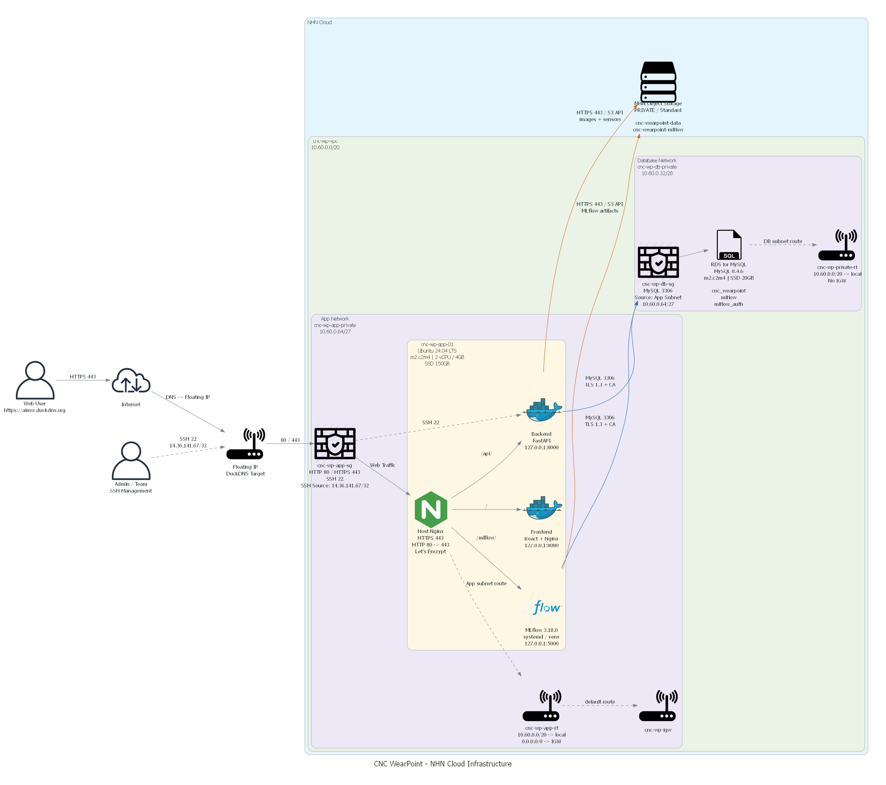

# CNC WearPoint Infrastructure

## 1. 문서 목적

이 문서는 CNC WearPoint 프로젝트의 **NHN Cloud 인프라 구성과 주요 네트워크 통신 구조**를 정리한 문서입니다.

현재 운영 중인 App VM과 RDS를 중심으로 VPC, Subnet, Route Table, Security Group, Floating IP, Nginx Reverse Proxy, Object Storage 등의 구조와 각 자원의 역할을 설명합니다.

CNC WearPoint 인프라는 다음 설계 원칙을 기준으로 구성했습니다.

- Application과 Database 영역을 서로 다른 Subnet으로 분리
- RDS는 외부 인터넷에 직접 노출하지 않음
- 외부 서비스 요청은 HTTPS 단일 진입점을 통해 처리
- Frontend, Backend, MLflow는 App VM 내부에서 역할별로 분리
- 구조화 데이터는 RDS에 저장
- 이미지, Sensor 데이터, MLflow Artifact는 Object Storage에 저장
- RDS 연결은 TLS 및 CA 인증서 검증 적용
- SSH 관리 접근은 허용된 공인 IP로 제한

---

## 2. 인프라 구성도

아래 구성도는 CNC WearPoint 서비스의 현재 NHN Cloud 인프라와 주요 네트워크 통신 흐름을 나타냅니다.



- [SVG 구성도](architecture/images/cnc_wp_infrastructure.svg)
- [구성도 생성 코드](architecture/diagrams/cnc_wp_infrastructure.py)

구성도는 Python `Diagrams`와 Graphviz를 사용해 코드로 관리합니다.

인프라 구성이 변경되면 동일한 Python 코드에서 PNG와 SVG를 다시 생성할 수 있도록 구성했습니다.

---

## 3. 전체 서비스 통신 흐름

현재 사용자 요청과 관리 접근은 서로 다른 흐름으로 구분합니다.

### 서비스 사용자 접근

```text
Web Browser
     │
     │ HTTPS 443
     ▼
aimw.duckdns.org
     │
     ▼
Internet
     │
     ▼
Floating IP
     │
     ▼
App Security Group
     │
     ▼
Host Nginx
     │
     ├── /         → Frontend
     ├── /api/     → Backend
     └── /mlflow/  → MLflow
```

서비스 외부 진입점은 다음 Domain입니다.

```text
https://aimw.duckdns.org
```

Nginx가 App VM의 단일 HTTPS 진입점 역할을 담당하며 요청 Path에 따라 내부 서비스로 전달합니다.

### 관리자 접근

```text
Admin / Team
     │
     │ SSH 22
     ▼
Internet
     │
     ▼
Floating IP
     │
     ▼
App Security Group
     │
     ▼
App VM
```

SSH는 전체 인터넷에 공개하지 않고 허용된 공인 IP의 `/32` 범위에서만 접근할 수 있도록 제한합니다.

---

## 4. 전체 네트워크 구성

CNC WearPoint는 다음 VPC를 기준으로 구성했습니다.

| 항목 | 구성 |
|---|---|
| VPC | `cnc-wp-vpc` |
| CIDR | `10.60.0.0/20` |
| App Subnet | `10.60.0.64/27` |
| Database Subnet | `10.60.0.32/28` |

전체 구조는 다음과 같습니다.

```text
cnc-wp-vpc
10.60.0.0/20
│
├── App Network
│   └── cnc-wp-app-private
│       10.60.0.64/27
│
└── Database Network
    └── cnc-wp-db-private
        10.60.0.32/28
```

Application과 Database를 서로 다른 Subnet에 배치해 네트워크 역할과 접근 정책을 분리했습니다.

VPC는 현재 사용량보다 여유 있는 `/20` 대역으로 구성하여 향후 Monitoring, Management, NKS Worker 등의 추가 Subnet을 구성할 수 있는 주소 공간을 확보했습니다.

---

## 5. App Network

### cnc-wp-app-private

Application 서버를 배치하는 Network입니다.

| 항목 | 구성 |
|---|---|
| Subnet | `cnc-wp-app-private` |
| CIDR | `10.60.0.64/27` |
| Route Table | `cnc-wp-app-rt` |
| Internet Gateway | `cnc-wp-igw` |
| 주요 자원 | `cnc-wp-app-01` |

App VM은 다음 역할을 담당합니다.

- Host Nginx
- Frontend Container
- Backend Container
- MLflow Tracking Server
- GitLab Runner
- Docker Compose 기반 배포
- RDS 접근
- Object Storage 접근

---

## 6. App VM

| 항목 | 구성 |
|---|---|
| Instance | `cnc-wp-app-01` |
| OS | Ubuntu Server 24.04 LTS |
| Instance Type | `m2.c2m4` |
| vCPU | 2 |
| Memory | 4 GB |
| Root Storage | SSD 150 GB |
| Floating IP | 사용 |
| Deletion Protection | 사용 |

초기 프로젝트 규모에서는 2 vCPU / 4 GB 사양으로 운영하고, 실제 서비스 부하에 따라 Instance Type을 확장할 수 있도록 구성했습니다.

Root Disk는 다음 요소에서 발생하는 I/O를 고려해 SSD 150 GB를 사용합니다.

- Docker Image
- Container Layer
- Application Source
- Python Package
- Log
- Cache
- 배포 관련 파일

이미지 및 Sensor 원본 파일은 현재 App VM의 Runtime Storage에 의존하지 않고 Object Storage에서 관리합니다.

---

## 7. App VM 내부 서비스 구성

App VM에는 다음 서비스가 실행됩니다.

```text
cnc-wp-app-01
│
├── Host Nginx
│   └── 80 / 443
│
├── Frontend Container
│   └── 127.0.0.1:8080
│
├── Backend Container
│   └── 127.0.0.1:8000
│
└── MLflow
    └── 127.0.0.1:5000
```

Frontend와 Backend는 Docker Container로 운영합니다.

MLflow는 현재 Docker Image로 운영하지 않고 Python Virtual Environment와 systemd를 사용합니다.

---

## 8. Nginx Reverse Proxy

Host Nginx는 CNC WearPoint 서비스의 **단일 외부 진입점** 역할을 합니다.

외부 사용자는 내부 서비스 Port에 직접 접근하지 않고 Nginx를 통해 접근합니다.

현재 Routing 구조:

| 요청 Path | 대상 |
|---|---|
| `/` | Frontend Container |
| `/api/` | FastAPI Backend |
| `/mlflow/` | MLflow Tracking Server |

구조:

```text
https://aimw.duckdns.org
          │
          ▼
        Nginx
          │
          ├── /        → 127.0.0.1:8080
          │
          ├── /api/    → 127.0.0.1:8000
          │
          └── /mlflow/ → 127.0.0.1:5000
```

이 구조를 통해 Frontend, Backend, MLflow의 내부 Port를 외부에 직접 공개하지 않고 Nginx를 통해 통합적으로 관리합니다.

---

## 9. Domain 및 HTTPS

서비스 Domain:

```text
aimw.duckdns.org
```

Domain은 App VM의 공인 접근 주소와 연결되어 있습니다.

HTTPS는 Nginx와 Let's Encrypt 인증서를 이용해 적용했습니다.

현재 주요 접근 주소:

```text
https://aimw.duckdns.org/
https://aimw.duckdns.org/api/
https://aimw.duckdns.org/mlflow/
```

HTTP 요청은 HTTPS로 Redirect합니다.

```text
HTTP 80
   │
   ▼
HTTPS 443
```

이를 통해 사용자가 IP 주소와 내부 Port를 직접 입력하지 않고 하나의 Domain으로 서비스에 접근할 수 있습니다.

---

## 10. App Routing

App Subnet은 `cnc-wp-app-rt` Route Table을 사용합니다.

| Destination | Target |
|---|---|
| `10.60.0.0/20` | local |
| `0.0.0.0/0` | `cnc-wp-igw` |

VPC 내부 자원과의 통신은 `local` 경로를 사용합니다.

외부 인터넷 통신이 필요한 경우 `cnc-wp-igw` Internet Gateway를 사용합니다.

App VM에서 필요한 외부 통신 예시는 다음과 같습니다.

- Package Download
- Container Image Pull
- Git Repository 접근
- Object Storage API
- Let's Encrypt 인증서 갱신

---

## 11. App Security Group

### cnc-wp-app-sg

App VM에 대한 외부 접근을 제어하는 Security Group입니다.

현재 주요 정책은 다음과 같습니다.

| Direction | Protocol | Port | Source / Destination |
|---|---|---:|---|
| Inbound | TCP | 22 | 허용된 공인 IP `/32` |
| Inbound | TCP | 80 | 서비스 접근 |
| Inbound | TCP | 443 | 서비스 접근 |
| Outbound | Any | Any | `0.0.0.0/0` |
| Outbound | Any | Any | `::/0` |

SSH는 전체 인터넷에 공개하지 않고 관리에 필요한 공인 IP만 `/32` 단위로 허용합니다.

HTTP와 HTTPS는 웹 서비스 제공을 위해 사용합니다.

---

## 12. Host Firewall

Cloud Security Group 외에 App VM 내부에서도 UFW를 사용합니다.

기본 정책:

```text
Incoming: deny
Outgoing: allow
```

주요 허용 Port:

```text
22   → 관리용 SSH
80   → HTTP
443  → HTTPS
```

SSH는 관리용 공인 IP로 제한합니다.

Cloud Security Group과 Host Firewall을 함께 사용해 외부 접근 범위를 이중으로 제한합니다.

---

## 13. Database Network

### cnc-wp-db-private

RDS for MySQL을 배치하기 위한 Database 전용 Private Subnet입니다.

| 항목 | 구성 |
|---|---|
| Subnet | `cnc-wp-db-private` |
| CIDR | `10.60.0.32/28` |
| Route Table | `cnc-wp-private-rt` |
| Internet Gateway | 연결하지 않음 |
| 주요 자원 | RDS for MySQL |

Database Network에는 Internet Gateway로 연결되는 기본 인터넷 경로를 구성하지 않았습니다.

RDS는 외부 인터넷에 직접 노출하지 않고 App Network에서 필요한 Database 요청만 받을 수 있도록 구성합니다.

---

## 14. Database Routing

Database Subnet은 `cnc-wp-private-rt` Route Table을 사용합니다.

| Destination | Target |
|---|---|
| `10.60.0.0/20` | local |

App VM과 RDS는 동일 VPC 내부에 있기 때문에 `local` Route를 통해 통신합니다.

Database Network에는 `0.0.0.0/0 → IGW` 경로를 구성하지 않습니다.

따라서 RDS가 Internet Gateway를 통해 외부 인터넷에 직접 노출되는 구조가 아닙니다.

---

## 15. DB Security Group

### cnc-wp-db-sg

RDS 접근 범위를 제한하는 Security Group입니다.

MySQL Port를 전체 인터넷에 공개하지 않고 App Subnet에서 발생하는 접근만 허용합니다.

| Direction | Protocol | Port | Source |
|---|---|---:|---|
| Inbound | TCP | 3306 | `10.60.0.64/27` |

Database 접근 흐름:

```text
Internet
   │
   X
   │
   └── RDS 직접 접근 불가


App VM
   │
   │ VPC Internal
   ▼
DB Security Group
   │
   ▼
RDS for MySQL
```

이를 통해 RDS에 필요한 최소 네트워크 접근만 허용합니다.

---

## 16. RDS for MySQL

서비스 Database와 MLflow Metadata Database는 NHN Cloud의 **RDS for MySQL**을 사용합니다.

| 항목 | 구성 |
|---|---|
| Database | RDS for MySQL |
| MySQL Version | 8.4.6 |
| Instance Type | `m2.c2m4` |
| vCPU | 2 |
| Memory | 4 GB |
| Storage Type | General SSD |
| Storage Size | 20 GB |
| Subnet | `cnc-wp-db-private` |
| Floating IP | 사용하지 않음 |
| Authentication Plugin | `caching_sha2_password` |
| Deletion Protection | 사용 |

현재 RDS에는 다음 Database를 분리해 사용합니다.

```text
RDS for MySQL
│
├── cnc_wearpoint
│   └── 서비스 데이터
│
├── mlflow
│   └── MLflow Metadata
│
└── mlflow_auth
    └── MLflow 인증 정보
```

서비스 데이터와 MLOps Metadata 및 인증 정보를 분리해 역할과 관리 범위를 명확히 했습니다.

---

## 17. RDS TLS 및 CA 검증

App VM에서 RDS로 연결할 때 단순 TCP 연결만 사용하지 않고 TLS 연결을 적용했습니다.

현재 검증된 연결:

```text
TLS Version
→ TLS 1.3

Cipher
→ TLS_AES_256_GCM_SHA384
```

NHN Cloud RDS CA 인증서는 다음 위치에서 관리합니다.

```text
/etc/mysql/certs/ca.pem
```

FastAPI와 MLflow 모두 해당 CA를 사용해 RDS 인증서를 검증합니다.

```text
FastAPI
   │
   │ TLS 1.3 + CA
   ▼
cnc_wearpoint


MLflow
   │
   │ TLS 1.3 + CA
   ├── mlflow
   └── mlflow_auth
```

이를 통해 App VM과 RDS 사이 Database 통신의 암호화와 인증서 검증을 적용했습니다.

---

## 18. Object Storage

대용량 파일은 RDS에 직접 저장하지 않고 NHN Cloud Object Storage에서 관리합니다.

현재 사용하는 Bucket:

| Bucket | 용도 |
|---|---|
| `cnc-wearpoint-data` | 서비스 이미지 및 Sensor 데이터 |
| `cnc-wearpoint-mlflow` | MLflow Artifact |

두 Bucket 모두 Private으로 관리합니다.

---

## 19. 서비스 Object Storage

서비스용 Object Storage:

```text
cnc-wearpoint-data
```

주요 구조:

```text
cnc-wearpoint-data
│
├── images/
│   ├── set4/
│   ├── set5/
│   └── ...
│
└── sensors/
    ├── set4/
    ├── set5/
    └── ...
```

현재 이전된 파일:

| 구분 | 파일 수 |
|---|---:|
| Image | 824 |
| Sensor | 895 |
| Total | 1,719 |

총 용량은 약 5.29 GB입니다.

FastAPI는 S3 Compatible API를 이용해 Object Storage에서 파일을 읽습니다.

```text
FastAPI
    │
    │ HTTPS / S3 API
    ▼
cnc-wearpoint-data
```

App VM의 Runtime에서는 기존 Local Storage Volume Mount를 제거한 상태에서도 이미지와 Sensor 조회가 정상 동작하는 것을 확인했습니다.

---

## 20. MLflow Object Storage

MLflow Artifact는 별도의 Bucket을 사용합니다.

```text
cnc-wearpoint-mlflow
```

저장 대상:

- Model Artifact
- Model Weight
- `MLmodel`
- Run Artifact
- 실험 결과 파일

구조:

```text
MLflow
   │
   │ S3 Compatible API
   ▼
cnc-wearpoint-mlflow
   │
   └── mlflow-artifacts/
```

MLflow Metadata는 RDS에 저장하고 실제 Artifact 파일은 Object Storage에 저장하도록 역할을 분리했습니다.

---

## 21. 서비스 데이터 흐름

현재 서비스의 주요 데이터 흐름은 다음과 같습니다.

```text
Web Browser
     │
     │ HTTPS
     ▼
aimw.duckdns.org
     │
     ▼
Host Nginx
     │
     ├── /
     │    ▼
     │  Frontend
     │
     └── /api/
          ▼
       FastAPI
          │
          ├── TLS 1.3 + CA
          │       ▼
          │   RDS MySQL
          │   cnc_wearpoint
          │
          └── HTTPS / S3 API
                  ▼
             Object Storage
             cnc-wearpoint-data
```

Frontend에서 API 요청을 수행할 때도 외부 Browser 요청은 Nginx의 `/api/` 경로를 통해 Backend로 전달됩니다.

Frontend Container에서 Backend Container로 직접 외부 Network 요청을 보내는 구조가 아닙니다.

---

## 22. MLflow 데이터 흐름

```text
User / Developer
       │
       │ HTTPS
       ▼
aimw.duckdns.org/mlflow/
       │
       ▼
     Nginx
       │
       ▼
     MLflow
       │
       ├── TLS 1.3 + CA
       │       ▼
       │    RDS MySQL
       │    ├── mlflow
       │    └── mlflow_auth
       │
       └── HTTPS / S3 API
               ▼
          Object Storage
          cnc-wearpoint-mlflow
```

MLflow의 Metadata와 Artifact를 서로 다른 저장소에서 관리합니다.

---

## 23. Network와 Storage 분리 기준

RDS와 Object Storage는 서로 다른 목적을 가집니다.

### RDS

구조화된 데이터를 저장합니다.

```text
Tool Set
Measurement Metadata
Wear Label
Prediction
Alert
Experiment
Run
Metric
Model Registry Metadata
Authentication Metadata
```

### Object Storage

대용량 파일을 저장합니다.

```text
Image
Sensor CSV
Model Artifact
Model Weight
MLmodel
Run Artifact
```

Database에는 파일 자체가 아니라 Object Key 또는 관련 Metadata를 저장합니다.

이를 통해 Database의 불필요한 용량 증가를 방지하고 파일 저장 영역을 독립적으로 확장할 수 있습니다.

---

## 24. 네트워크 분리 이유

App 서버와 Database를 하나의 Network에 배치할 수도 있지만 CNC WearPoint에서는 역할에 따라 Network를 분리했습니다.

### App Network

외부 서비스 요청, 관리자 접근, Application 실행이 필요한 서버를 배치합니다.

### Database Network

외부 인터넷에 직접 노출할 필요가 없는 RDS를 배치합니다.

이를 통해 다음과 같은 효과를 얻을 수 있습니다.

- App과 Database 역할 분리
- RDS 직접 인터넷 노출 방지
- Security Group을 이용한 최소 통신 허용
- 장애 범위 분리
- Network 정책 관리 단순화
- 향후 서비스 확장 시 Subnet 단위 정책 적용

---

## 25. Security Layer

현재 서비스에는 여러 단계의 접근 제어를 적용합니다.

```text
Internet
   │
   ▼
Security Group
   │
   ▼
UFW
   │
   ▼
Nginx HTTPS
   │
   ▼
Application
   │
   ▼
RDS TLS + CA
```

주요 보안 구성:

- SSH `/32` 제한
- HTTP/HTTPS Port 분리
- UFW Incoming 기본 Deny
- RDS Private Subnet
- RDS Floating IP 미사용
- DB Security Group Source 제한
- RDS TLS 1.3
- CA 인증서 검증
- Object Storage Private Bucket
- Credential Environment File 관리
- Nginx HTTPS 적용

---

## 26. 구성도 표기 기준

구성도는 실제 요청 흐름과 Network 설정 관계를 구분해서 표현합니다.

### 실선

실선은 실제 주요 통신 흐름을 나타냅니다.

예:

```text
Browser
→ Floating IP
→ Nginx
→ FastAPI
→ RDS
```

또는:

```text
FastAPI
→ Object Storage
```

### 점선

점선은 Route Table, Internet Gateway 등 **Network Configuration 관계**를 나타냅니다.

예:

```text
App Subnet
--- uses --->
App Route Table
--- default route --->
Internet Gateway
```

점선은 Application Request가 순서대로 전달되는 경로를 의미하지 않습니다.

---

## 27. 주요 설계 기준

### App과 Database Network 분리

서비스를 실행하는 App VM과 데이터를 저장하는 RDS를 서로 다른 Subnet에 배치했습니다.

### RDS 비공개 구성

RDS에는 Floating IP를 사용하지 않고 Internet Gateway로 연결되는 Default Route도 구성하지 않았습니다.

### Nginx 단일 진입점

외부에 Frontend, Backend, MLflow의 Port를 각각 공개하지 않고 Nginx의 80/443만 외부 서비스 진입점으로 사용합니다.

### HTTPS 적용

DuckDNS Domain과 Let's Encrypt 인증서를 이용해 HTTPS를 적용했습니다.

### 관리 접근 제한

SSH Port는 전체 인터넷이 아닌 허용된 관리 IP에서만 접근할 수 있도록 제한했습니다.

### Database 통신 암호화

FastAPI와 MLflow의 RDS 연결에 TLS 1.3과 CA 인증서 검증을 적용했습니다.

### 파일 저장소 분리

Image, Sensor, MLflow Artifact는 Object Storage로 분리했습니다.

### 확장 가능한 VPC

현재 필요한 Subnet보다 넓은 `/20` VPC CIDR을 사용해 향후 Network 확장 여유를 확보했습니다.

---

## 28. 현재 구성 요약

현재 CNC WearPoint Infrastructure의 주요 구조는 다음과 같습니다.

```text
                        Internet
                           │
                    aimw.duckdns.org
                           │
                           ▼
                      Floating IP
                           │
                           ▼
                    cnc-wp-app-sg
                           │
                           ▼
                    cnc-wp-app-01
                           │
                    Host Nginx :443
                ┌──────────┼──────────┐
                │          │          │
                ▼          ▼          ▼
           Frontend     Backend     MLflow
            :8080        :8000       :5000
                           │            │
              ┌────────────┘            │
              │                         │
              ▼                         ▼
         RDS for MySQL             RDS for MySQL
        cnc_wearpoint              mlflow
                                  mlflow_auth

              │                         │
              ▼                         ▼
        Object Storage             Object Storage
      cnc-wearpoint-data       cnc-wearpoint-mlflow
       images / sensors            artifacts
```

관리 접근:

```text
Admin
  │
  │ SSH 22 / 허용된 IP
  ▼
Floating IP
  │
  ▼
App VM
```

Database는 외부에서 직접 접근할 수 없으며 App Network를 통해서만 접근합니다.

---

## 29. 현재 상태

현재 인프라 상태는 다음과 같이 정리할 수 있습니다.

```text
VPC_NETWORK_READY
APP_VM_READY
RDS_PRIVATE_NETWORK_READY
HTTPS_READY
NGINX_ROUTING_READY
RDS_TLS_CA_VERIFIED
OBJECT_STORAGE_READY
FASTAPI_OBJECT_STORAGE_VERIFIED
MLFLOW_RDS_READY
MLFLOW_ARTIFACT_STORE_READY
```

초기 단계의 단순 App VM + RDS 구성에서 확장하여 현재는 다음까지 구성된 상태입니다.

```text
Domain
→ HTTPS
→ Nginx
→ Frontend / Backend / MLflow
→ RDS / Object Storage
```

서비스 데이터는 RDS와 Object Storage에 역할별로 분리되어 있으며, Database 통신에는 TLS 및 CA 인증서 검증을 적용했습니다.

---

## 30. 향후 개선 사항

현재 구성은 팀 프로젝트 규모의 단일 App VM 구조입니다.

향후 서비스 규모가 증가하면 다음 항목을 검토할 수 있습니다.

### Load Balancer

현재는 Floating IP와 Host Nginx를 직접 사용합니다.

향후 다중 App Instance를 운영하는 경우 Load Balancer 도입을 검토할 수 있습니다.

### Application 고가용성

현재 Frontend, Backend, MLflow가 하나의 App VM에서 동작합니다.

서비스 규모가 증가하면 역할별 Instance 분리 또는 Container Orchestration 환경으로 확장할 수 있습니다.

### Monitoring Network

Prometheus, Grafana 등의 Monitoring 환경이 필요할 경우 별도 Monitoring Subnet을 구성할 수 있습니다.

### Management Network

관리용 Bastion Host 또는 관리 시스템이 필요한 경우 별도의 Management Subnet을 구성할 수 있습니다.

### Security 강화

향후 필요에 따라 다음을 검토할 수 있습니다.

- X509 / mTLS
- Object Storage IAM 최소 권한
- Credential Rotation
- WAF
- Load Balancer TLS Termination
- 중앙 Log 관리

---

## 31. 결론

CNC WearPoint Infrastructure는 단순히 VM과 Database를 생성하는 방식이 아니라 **서비스 역할에 따라 Network, Database, Storage 및 접근 경로를 분리하는 구조**로 구성했습니다.

App VM은 외부 서비스 요청을 처리하고, RDS는 Private Network에서 구조화 데이터를 저장합니다.

Nginx를 단일 HTTPS 진입점으로 사용해 Frontend, Backend, MLflow를 Path 기반으로 연결하며, 이미지·Sensor 파일 및 MLflow Artifact는 Object Storage에서 별도로 관리합니다.

또한 RDS 통신에는 TLS 1.3과 CA 인증서 검증을 적용하여 Network 분리뿐 아니라 Database 통신 구간의 보안도 강화했습니다.

현재 구조는 팀 프로젝트 규모에서 운영 가능하면서도 향후 Load Balancer, 다중 App Instance, Monitoring Network, Container Orchestration 등으로 확장할 수 있도록 구성했습니다.